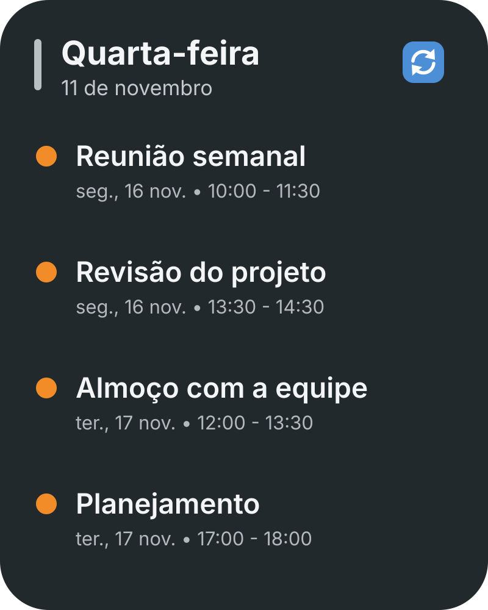

# Widgets for Android

**Beautiful, ultra-light home screen widgets — Material You, fully offline, zero tracking.**

Widgets is a small, privacy-first Android app that brings polished, customizable widgets to your home screen. It ships with a Google Calendar agenda widget and a photo frame widget, and it is built to stay out of your way: no accounts, no ads, no analytics — and no `INTERNET` permission at all.


> 🇧🇷 [Leia esta página em Português](README.md)

---

## ✨ Highlights

- **Material You** — widgets follow the dynamic colors extracted from your wallpaper and themed icons on Android 12+.
- **Tiny footprint** — around 3 MB in the release build, with no always-on services and no polling loops.
- **Privacy by design** — the app has no internet permission, so your data physically cannot leave your device.
- **Battery friendly** — updates are driven by system events (calendar changes, screen unlock, alarms), not by background sync.
- **Made to grow** — a clean, modular widget architecture. New widget modules are genuinely welcome.

## 🧩 Included widgets

### 🗓️ Calendar

A customizable agenda widget that reads your calendars directly on-device through `CalendarContract` — no cloud API, no sign-in flow, no latency.

- Agenda list or single *next event* layout
- Adjustable background opacity (from full glass to solid), corner radius and border
- Live refresh when events change on the device
- Optional quick-refresh button, and tap an event to open it in your calendar app
- Works offline with the calendars already synced to your phone
- Requires only `READ_CALENDAR`

### 🖼️ Photo frame

A tasteful photo widget with no counters or badges over your images.

- Native Android Photo Picker — no storage permissions
- Rounded rectangle, squircle, circle/oval shapes
- Optional passe-partout frame with Material You colors
- Rotation on every unlock, on a timer (15 min → 24 h), or on tap
- Photos are downscaled and copied into private app storage, then shared only when you tap to open them (scoped `FileProvider` grant)

## 📸 Screenshots

| Calendar | Photo frame |
| :---: | :---: |
|  |  |

## 📱 Requirements

- Android 12 (API 31) or newer — built and tested against Android 15/16/17 behavior
- Compiled with `minSdk 31` / `targetSdk 35`

## 🚀 Build from source

You need **JDK 17** and the **Android SDK** (platform 35).

```bash
git clone https://github.com/pedoandrade/widges.git
cd widges
./gradlew assembleDebug
```

The APK is written to `app/build/outputs/apk/debug/app-debug.apk`, or open the project in Android Studio and press **Run**.

For a minified release build:

```bash
./gradlew assembleRelease
```

Release signing is configured through a local `keystore.properties` file (ignored by Git):

```properties
storeFile=keystore/your-release.keystore
storePassword=...
keyAlias=...
keyPassword=...
```

## 🏗️ Architecture

```text
app/src/main/java/com/pedro/widgets/
├── data/
│   ├── model/          # Per-widget configuration models
│   ├── repository/     # On-device CalendarContract queries
│   └── storage/        # DataStore preferences + private photo storage
├── ui/theme/           # Compose Material 3 theme
└── widget/
    ├── calendar/       # Glance widget, configuration screen, receiver
    └── photo/          # Glance widget, configuration screen, receiver
```

- **Jetpack Glance** renders the widgets; **Compose + Material 3** powers the configuration screens.
- Preferences are stored per `appWidgetId` in Jetpack DataStore.
- Photos are decoded with sampling, downscaled, and saved to internal storage — never to shared storage.
- Configuration activities validate that the incoming `appWidgetId` belongs to this app.
- Widget receivers are not exported, and all click intents are scoped.

### Tech stack

| Layer | Technology |
| :--- | :--- |
| Language | Kotlin 2.x |
| Widgets | Jetpack Glance, Glance Material 3 |
| Configuration UI | Jetpack Compose, Material 3 |
| Preferences | Jetpack DataStore |
| Images | Coil (local files) |
| Minification | R8 |

## 🤝 Contributing

Contributions are very welcome — especially **new widget modules**. This project is meant to be a small, friendly playground for building lightweight, privacy-respecting widgets.

1. Fork the repository and create a branch: `git checkout -b feat/clock-widget`
2. Build your module following the existing calendar/photo pattern.
3. Test on an Android 12+ device or emulator (newer API levels are a plus).
4. Open a pull request describing the widget, its configuration options and any screenshots.

### Ground rules

- **Privacy first.** Do not add the `INTERNET` permission, advertising/analytics SDKs, or new dangerous permissions without discussing it in an issue first.
- **Keep it light.** Avoid polling, foreground services and heavy dependencies.
- **Store private data internally.** Never write user media or preferences to shared/external storage.
- **No exported components.** Widget receivers stay `exported="false"`; configuration activities validate the widget ID.
- Follow the existing Kotlin/Compose style and keep user-facing strings in `strings.xml`.

### Module checklist

- [ ] `GlanceAppWidget` + `GlanceAppWidgetReceiver`
- [ ] `appwidget-provider` XML with `widgetFeatures="reconfigurable"`
- [ ] Compose configuration screen with a live preview
- [ ] `appWidgetId` ownership validation
- [ ] Per-widget preferences in `WidgetPreferences`
- [ ] Cleanup of any files created by the widget on deletion (`onDeleted`)
- [ ] Preview image, icon, strings and dark/light theme check

### Ideas for new modules

Clock, battery, notes, habit tracker, countdown, world clock, quick actions, storage monitor, media controls, local weather (would require an opt-in network design — open an issue first).

## 🗺️ Roadmap

- More built-in modules
- Theme presets shared across widgets
- User-initiated local export/import of widget layouts
- Community translations

## 🔐 Privacy

- No `INTERNET` permission — the app cannot upload anything.
- Calendar data is read locally and never persisted; only your own calendars are queried with `READ_CALENDAR`.
- Photos are selected through the system Photo Picker and copied to private internal storage.
- Android auto-backup is disabled, so photos and widget preferences are not sent to cloud backup or device-to-device transfer by this app.
- No ads, no analytics, no trackers, no third-party data collection.

## 📄 License

Distributed under the **MIT License**. See [`LICENSE`](LICENSE) for details.
