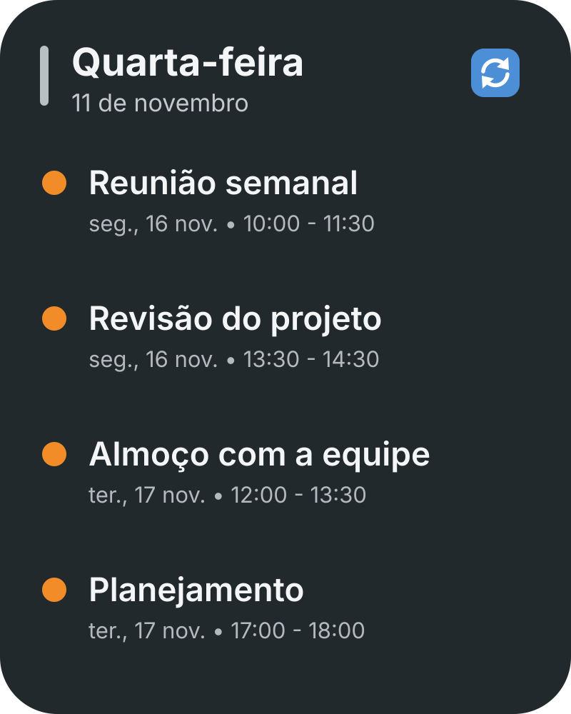

# Widgets para Android

**Widgets de tela inicial bonitos e ultraleves — Material You, totalmente offline e sem rastreamento.**

Widgets é um aplicativo Android pequeno e focado em privacidade que leva widgets elegantes e personalizáveis para a sua tela inicial. Ele vem com um widget de agenda do Google Calendar e um widget de porta-retratos, e foi feito para não atrapalhar: sem contas, sem anúncios, sem analytics — e sem a permissão `INTERNET`.


> 🇺🇸 [Read this page in English](README.en.md)

---

## ✨ Destaques

- **Material You** — os widgets acompanham as cores dinâmicas extraídas do papel de parede e dos ícones temáticos no Android 12+.
- **Pegada mínima** — cerca de 3 MB na versão release, sem serviços sempre ativos e sem polling.
- **Privacidade por padrão** — o app não tem permissão de internet, então seus dados fisicamente não podem sair do aparelho.
- **Economia de bateria** — as atualizações são guiadas por eventos do sistema (mudanças na agenda, desbloqueio da tela, alarmes), não por sincronização em segundo plano.
- **Feito para crescer** — arquitetura modular e limpa. Novos módulos de widget são muito bem-vindos.

## 🧩 Widgets incluídos

### 🗓️ Agenda

Um widget de agenda personalizável que lê seus calendários diretamente no dispositivo através do `CalendarContract` — sem API em nuvem, sem fluxo de login e sem latência.

- Layout em lista de compromissos ou em *próximo evento*
- Opacidade do fundo ajustável (de vidro total a sólido), raio dos cantos e contorno
- Atualização automática quando os eventos mudam no aparelho
- Botão opcional de atualização rápida e toque no evento para abri-lo no app de agenda
- Funciona offline com os calendários já sincronizados no celular
- Requer apenas `READ_CALENDAR`

### 🖼️ Porta-retratos

Um widget de fotos elegante, sem contadores ou badges sobre as suas imagens.

- Seletor nativo de fotos do Android (Photo Picker) — sem permissões de armazenamento
- Formatos retangular arredondado, squircle e círculo/oval
- Moldura externa (*passe-partout*) opcional com cores do Material You
- Rotação a cada desbloqueio, por temporizador (15 min → 24 h) ou ao toque
- As fotos são redimensionadas e copiadas para o armazenamento interno privado, sendo compartilhadas apenas quando você toca para abri-las (concessão temporária via `FileProvider`)

## 📸 Capturas de tela

| Agenda | Porta-retratos |
| :---: | :---: |
|  |  |

## 📱 Requisitos

- Android 12 (API 31) ou superior — desenvolvido e testado com o comportamento do Android 15/16/17
- Compilado com `minSdk 31` / `targetSdk 35`

## 🚀 Compilando do código-fonte

Você precisa de **JDK 17** e do **Android SDK** (platform 35).

```bash
git clone https://github.com/pedoandrade/widges.git
cd widges
./gradlew assembleDebug
```

O APK é gerado em `app/build/outputs/apk/debug/app-debug.apk`, ou abra o projeto no Android Studio e pressione **Run**.

Para gerar a versão release minificada:

```bash
./gradlew assembleRelease
```

A assinatura de release é configurada por um arquivo local `keystore.properties` (ignorado pelo Git):

```properties
storeFile=keystore/your-release.keystore
storePassword=...
keyAlias=...
keyPassword=...
```

## 🏗️ Arquitetura

```text
app/src/main/java/com/pedro/widgets/
├── data/
│   ├── model/          # Modelos de configuração por widget
│   ├── repository/     # Consultas locais ao CalendarContract
│   └── storage/        # Preferências em DataStore + armazenamento privado de fotos
├── ui/theme/           # Tema Compose Material 3
└── widget/
    ├── calendar/       # Widget Glance, tela de configuração e receiver
    └── photo/          # Widget Glance, tela de configuração e receiver
```

- **Jetpack Glance** renderiza os widgets; **Compose + Material 3** alimenta as telas de configuração.
- As preferências são armazenadas por `appWidgetId` no Jetpack DataStore.
- As fotos são decodificadas com amostragem, redimensionadas e salvas no armazenamento interno — nunca no armazenamento compartilhado.
- As telas de configuração validam se o `appWidgetId` recebido pertence a este aplicativo.
- Os receivers dos widgets não são exportados e todos os intents de clique são restritos.

### Tecnologias

| Camada | Tecnologia |
| :--- | :--- |
| Linguagem | Kotlin 2.x |
| Widgets | Jetpack Glance, Glance Material 3 |
| Interface de configuração | Jetpack Compose, Material 3 |
| Preferências | Jetpack DataStore |
| Imagens | Coil (arquivos locais) |
| Minificação | R8 |

## 🤝 Contribuindo

Contribuições são muito bem-vindas — especialmente **novos módulos de widget**. Este projeto foi pensado para ser um espaço pequeno e amigável para construir widgets leves e que respeitam a privacidade.

1. Faça um fork do repositório e crie uma branch: `git checkout -b feat/clock-widget`
2. Construa seu módulo seguindo o padrão dos widgets de agenda e de fotos.
3. Teste em um aparelho ou emulador Android 12+ (níveis de API mais recentes são um diferencial).
4. Abra um pull request descrevendo o widget, suas opções de configuração e capturas de tela.

### Regras do projeto

- **Privacidade em primeiro lugar.** Não adicione a permissão `INTERNET`, SDKs de anúncios/analytics ou novas permissões perigosas sem discutir antes em uma issue.
- **Mantenha leve.** Evite polling, serviços em primeiro plano e dependências pesadas.
- **Armazene dados privados internamente.** Nunca grave mídia do usuário ou preferências no armazenamento compartilhado/externo.
- **Sem componentes exportados.** Receivers de widget permanecem `exported="false"`; telas de configuração validam o ID do widget.
- Siga o estilo Kotlin/Compose existente e mantenha os textos de interface em `strings.xml`.

### Checklist de um novo módulo

- [ ] `GlanceAppWidget` + `GlanceAppWidgetReceiver`
- [ ] XML `appwidget-provider` com `widgetFeatures="reconfigurable"`
- [ ] Tela de configuração em Compose com pré-visualização ao vivo
- [ ] Validação de propriedade do `appWidgetId`
- [ ] Preferências por widget em `WidgetPreferences`
- [ ] Limpeza de arquivos criados pelo widget ao excluí-lo (`onDeleted`)
- [ ] Imagem de prévia, ícone, strings e conferência dos temas claro/escuro

### Ideias de novos módulos

Relógio, bateria, notas, rastreador de hábitos, contagem regressiva, relógio mundial, ações rápidas, monitor de armazenamento, controles de mídia, clima local (exigiria um design de rede opt-in — abra uma issue primeiro).

## 🗺️ Roadmap

- Mais módulos nativos
- Presets de tema compartilhados entre widgets
- Exportação/importação local de layouts de widget iniciada pelo usuário
- Traduções da comunidade

## 🔐 Privacidade

- Sem permissão `INTERNET` — o app não consegue enviar nada.
- Os dados da agenda são lidos localmente e nunca persistidos; apenas os seus próprios calendários são consultados com `READ_CALENDAR`.
- As fotos são selecionadas pelo Photo Picker do sistema e copiadas para o armazenamento interno privado.
- O backup automático do Android está desativado, então fotos e preferências dos widgets não são enviadas para backup em nuvem ou transferência entre aparelhos por este app.
- Sem anúncios, sem analytics, sem rastreadores e sem coleta de dados por terceiros.

## 📄 Licença

Distribuído sob a licença **MIT**. Veja [`LICENSE`](LICENSE) para mais detalhes.
